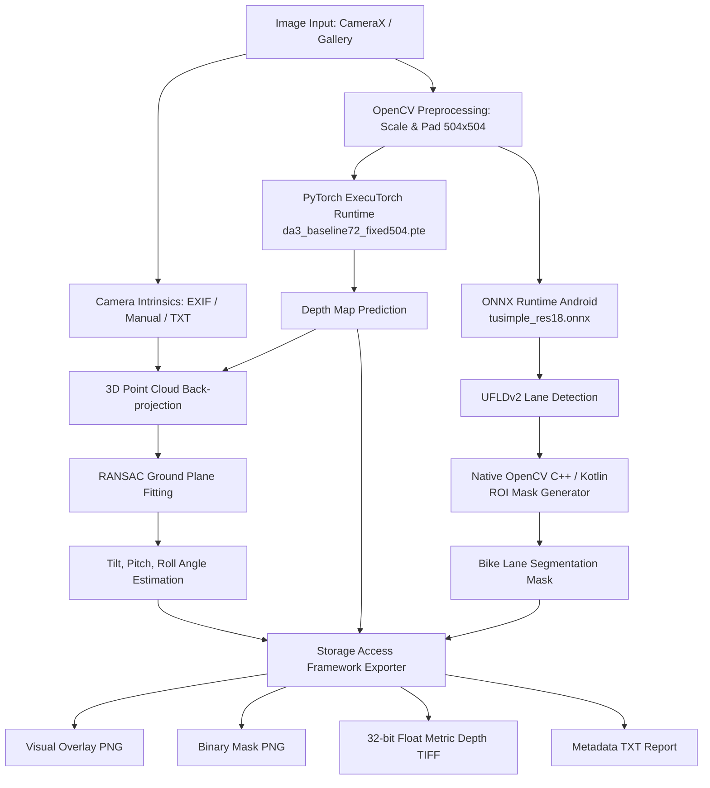

# DA3Camera v2 (CameraDepthLane)

[](https://developer.android.com/)
[](https://kotlinlang.org/)
[](https://pytorch.org/executorch/)
[](https://onnxruntime.ai/)
[](https://opencv.org/)

**DA3Camera v2** is an Android application designed for real-time monocular depth estimation, lane detection, 3D ground plane estimation, and bike lane segmentation.

The app combines PyTorch **ExecuTorch** for monocular depth estimation (**Depth Anything v2**), **ONNX Runtime Android** for Ultra-Fast Lane Detection (**UFLDv2**), **OpenCV NDK (C++)** for native image processing and ROI mask generation, and **RANSAC 3D back-projection** for camera tilt/pitch/roll angle estimation.

---

## 📸 Key Features & Capabilities

- **Monocular Depth Estimation**: Runs PyTorch ExecuTorch (`da3_baseline72_fixed504.pte`) on-device to predict relative and metric depth maps.
- **Ultra-Fast Lane Detection (UFLDv2)**: Uses ONNX Runtime (`tusimple_res18.onnx`) to detect ego-lane boundaries (left and right lanes).
- **Bike Lane ROI Segmentation**: Combines detected lane boundaries to generate binary segmentation masks and visual overlays using native OpenCV C++ (`libnative-lib.so`) and Kotlin (`RoiMaskGenerator.kt`).
- **Camera Intrinsics Integration**:
  - Captures high-resolution photos using **CameraX** and automatically extracts hardware lens intrinsics (`fx`, `fy`, `cx`, `cy`) directly from Camera2 metadata (`LENS_INTRINSICS`).
  - Writes camera intrinsics to EXIF metadata in captured JPEG images.
  - Allows manual entry or bulk import of camera intrinsics from `.txt` configuration files for gallery images.
- **3D Spatial Geometry & RANSAC Plane Fitting**:
  - Back-projects 2D image coordinates and metric depth into 3D spatial points $(X, Y, Z)$.
  - Fits ground plane equations ($ax + by + cz + d = 0$) using RANSAC.
  - Computes camera orientation parameters including ground plane tilt angle, pitch, and roll in degrees.
- **Comprehensive Data Export**: Exports processed results using Android's Storage Access Framework (SAF):
  - 🎨 **Visual Overlay PNG** (`*_bikelane_overlay.png`): Original frame with rendered lane lines and semi-transparent bike lane polygon overlay.
  - ⬛ **Binary Mask PNG** (`*_segmentation.png`): Monochrome binary mask of the detected bike lane region.
  - 📐 **Metric Depth TIFF** (`*_metric_depth.tiff`): 32-bit floating-point single-channel TIFF depth map containing metric depth values in meters.
  - 📝 **Classification & Metadata TXT** (`*_classification.txt`): Text summary containing processing durations, camera intrinsics, depth statistics, RANSAC plane parameters, camera tilt angles, and lane bottom anchor coordinates.

---

## 🏗️ System Architecture



### Technology Stack

| Component | Library / Framework | Purpose |
| :--- | :--- | :--- |
| **Depth Engine** | ExecuTorch `org.pytorch:executorch-android:1.5.1` | On-device execution of exported PyTorch Depth Anything v2 model (`.pte`) |
| **Lane Engine** | ONNX Runtime `com.microsoft.onnxruntime:onnxruntime-android:1.31.1` | Execution of ResNet-18 UFLDv2 lane detection model (`.onnx`) |
| **Computer Vision** | OpenCV Android `org.opencv:opencv:4.10.0` | Native C++ / Java image transformations, interpolation, polygon filling |
| **Camera Framework**| Jetpack CameraX `1.4.2` | Camera preview, frame capture, hardware intrinsics metadata extraction |
| **Geometry Math** | Custom Kotlin RANSAC (`RansacUtils.kt`) | 3D back-projection and ground plane estimation |
| **Native Bridge** | NDK CMake + C++17 (`libnative-lib.so`) | Fast C++ native array processing and ROI mask creation |

---

## 📦 Model Files & GitHub Release Assets

Because AI model files exceed GitHub's standard **100 MB** file size limit per commit, the pre-trained models are **hosted as GitHub Release Assets** rather than checked directly into the git repository.

### Required Model Files

| Model File | Size | Format | Description | Target Path in Project |
| :--- | :--- | :--- | :--- | :--- |
| **`da3_baseline72_fixed504.pte`** | ~941 MB | ExecuTorch (`.pte`) | Monocular Depth Anything v2 exported for ExecuTorch (504x504 input) | `app/src/main/assets/da3_baseline72_fixed504.pte` |
| **`tusimple_res18.onnx`** | ~368 MB | ONNX (`.onnx`) | Ultra-Fast Lane Detection v2 ResNet-18 model trained on TuSimple | `app/src/main/assets/tusimple_res18.onnx` |

---

## 📥 How to Download & Setup Model Assets

### Option 1: Download from GitHub Releases (Recommended)

1. Go to the [DA3Camera_v2 GitHub Releases](https://github.com/laurapzz/DA3Camera_v2/releases).
2. Download both model files:
   - `da3_baseline72_fixed504.pte`
   - `tusimple_res18.onnx`
3. Place both downloaded files into your project directory:
   ```bash
   DA3Camera_v2/app/src/main/assets/
   ```

### Option 2: Upload Models to Release Assets (For Repository Maintainers)

If you are maintaining or updating the repository models, use the **GitHub CLI (`gh`)** or Web UI to attach model files to a release:

#### Using GitHub CLI (`gh`):
```bash
# 1. Create a release tag and upload model assets
gh release create v1.0.0 \
  app/src/main/assets/da3_baseline72_fixed504.pte \
  app/src/main/assets/tusimple_res18.onnx \
  --repo laurapzz/DA3Camera_v2 \
  --title "DA3Camera v1.0.0 Model Assets" \
  --notes "ExecuTorch depth model (da3_baseline72_fixed504.pte) and UFLDv2 lane model (tusimple_res18.onnx)."
```

#### Using GitHub Web Interface:
1. Open [https://github.com/laurapzz/DA3Camera_v2/releases/new](https://github.com/laurapzz/DA3Camera_v2/releases/new).
2. Create a new tag (e.g., `v1.0.0`).
3. Title: `DA3Camera v1.0.0 Models`.
4. Drag and drop `da3_baseline72_fixed504.pte` and `tusimple_res18.onnx` into the **Attach binaries** section.
5. Click **Publish release**.

> **Note**: Both `.pte` and `.onnx` extensions in `app/src/main/assets/` are configured in `.gitignore` to prevent committing heavy binaries to git history.

---

## 🚀 Getting Started & Building

### Prerequisites

- **Android Studio**: Ladybug / Meerkat (2024.2+) or newer.
- **Android SDK**: `compileSdk 37`, `minSdk 28` (Android 9.0+).
- **Android NDK**: Version `26.1.10909125`.
- **CMake**: Version `3.22.1` or higher.
- **JDK**: Version 17.

### Building from Source

1. **Clone the Repository**:
   ```bash
   git clone https://github.com/laurapzz/DA3Camera_v2.git
   cd DA3Camera_v2
   ```

2. **Add Model Assets**:
   Ensure `da3_baseline72_fixed504.pte` and `tusimple_res18.onnx` are placed inside:
   `app/src/main/assets/`

3. **Build Debug APK**:
   ```bash
   ./gradlew assembleDebug
   ```

4. **Install on Device**:
   ```bash
   ./gradlew installDebug
   ```

---

## 📱 How to Use the App

1. **Launch DA3Camera**: Open the app on your physical Android device.
2. **Select Image Source**:
   - **Take Photo**: Launches CameraX. The app automatically captures hardware lens intrinsics (`fx`, `fy`, `cx`, `cy`) from Camera2 hardware attributes and embeds them into EXIF data.
   - **Choose from Gallery**: Pick an existing image from your photo library.
3. **Configure Camera Intrinsics**:
   - If captured via the app camera, intrinsics are auto-populated.
   - For gallery images, manually enter `fx`, `fy`, `cx`, `cy`, or tap **Import Intrinsics from .txt** to load a formatted text file.
4. **Select Output Directory**:
   - Tap **Select Output Folder** to choose a destination directory via Storage Access Framework.
5. **Process Image**:
   - Tap **Process Image**. The app executes depth estimation, lane detection, ROI mask generation, 3D back-projection, and RANSAC plane fitting in parallel background threads.
6. **Inspect & Export Results**:
   - View the visual depth map preview directly on screen.
   - All exported files (`*_bikelane_overlay.png`, `*_segmentation.png`, `*_metric_depth.tiff`, `*_classification.txt`) are saved automatically to your chosen output folder.

---

## 📂 Project Structure

```
DA3Camera_v2/
├── app/
│   ├── build.gradle.kts           # App dependencies (ExecuTorch, ONNX, OpenCV, CameraX)
│   └── src/
│       └── main/
│           ├── AndroidManifest.xml # Permissions & activity declarations
│           ├── assets/            # Model assets directory (*.pte, *.onnx)
│           ├── cpp/
│           │   ├── CMakeLists.txt # NDK build script for OpenCV native code
│           │   └── native-lib.cpp # C++ implementation of bike lane ROI mask generation
│           ├── java/com/example/da3camera/
│           │   ├── MainActivity.kt     # Main UI, pipeline orchestration & SAF export
│           │   ├── CameraActivity.kt   # CameraX integration & lens intrinsics capture
│           │   ├── DA3ModelLoader.kt   # ExecuTorch model preparation & loading
│           │   ├── DA3Preprocessor.kt  # OpenCV image scaling & padding for 504x504
│           │   ├── LaneDetector.kt     # ONNX Runtime UFLDv2 inference runner
│           │   ├── Ufldv2Utils.kt      # Lane detection pipeline & C++ JNI bridge
│           │   ├── RoiMaskGenerator.kt # Kotlin polygon mask and overlay renderer
│           │   └── RansacUtils.kt      # 3D back-projection & RANSAC ground plane fitting
│           └── res/                    # UI layouts and XML resources
├── build.gradle.kts                # Project root build file
├── settings.gradle.kts             # Subproject settings
├── .gitignore                      # Git ignore rules (excluding large models)
└── README.md                       # Documentation
```

---

## 📄 License

This project is developed for research and development purposes.
